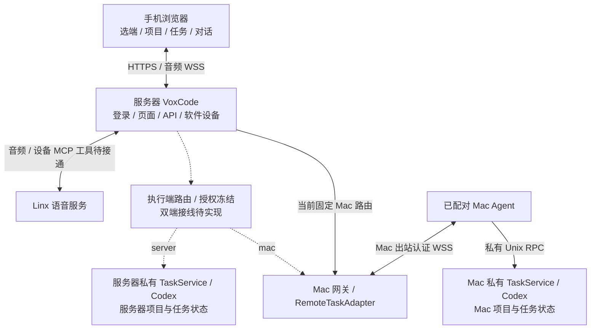

# VoxCode

VoxCode 在手机浏览器中管理 Codex 项目与任务。最新目标支持在页面选择**服务器
Codex 或已配对 Mac Codex**，项目、任务、会话、请求和语音按 `executionTarget`
隔离；登录不依赖 Mac Agent 在线。当前正式控制面仍固定 Mac 路由，双端选择尚待接线。

## 当前架构与状态

下图表示目标架构，虚线为待接线部分；Mac Agent 主动出站连接服务器。



项目 → 任务 → 子任务；主命令「新建项目」支持所选端已有目录与新建目录，项目行
`+` 创建任务。同任务追问使用该端该任务已保存的 UUID。提交文字或语音执行指令
直接执行，保留修订号、请求去重、目标归属、沙箱和 Codex 自身权限检查。
登录成功、控制服务可达和所选执行端在线状态分别记录。

| 能力 | 当前边界 |
| --- | --- |
| Mac 控制与正式语音传输 | 已有严格 CA HTTPS/WSS、配对 Mac 在线、合成音频 ASR 与 Mac Codex 写入证据；探针使用旧创建/确认流程 |
| 同 UUID 续聊核心 | [PR #127](https://github.com/liyan-04/voxcode/pull/127) 已合入 `f28553f`；[#124](https://github.com/liyan-04/voxcode/issues/124) 页面候选未部署 |
| 项目登记 / 提交即执行 / 双执行端 | 产品合同已明确，项目/API/页面与按端隔离的组合接线仍待交付 |
| 设备侧 MCP 语音控制 | SDK 支持 `tools/list` / `tools/call`，正式 provider 仍注册空工具；实际执行→结构化结果→继续语音未交付 |
| 手机验收 | 正式合成音频探针不证明实际 iPhone 麦克风、TTS、设备 MCP 或蜂窝网络成功 |

完整组件图、文字追问/语音工具时序、各 Issue 状态及回滚边界见
[当前架构](docs/architecture/phone-mac-linx-current.md)；协议见
[Mac 控制面合同](docs/architecture/mac-agent-control.md)。

## Linux 控制面与 Mac 执行端

两端统一使用根目录的 shell 脚本。在**目标服务主机**的 Git checkout 中执行，
Linux 由 root 管理专用非 root 控制服务账户，Mac 由当前 GUI 账户管理执行端：

```sh
# 首次按部署说明准备私有配置，将配置路径设置一次。
export VOXCODE_DEPLOY_CONFIG=/absolute/private/deployment.json
./install.sh       # 检查环境、安装锁定依赖、注册服务；不启动
./start.sh         # Linux 启动控制面；Mac 先任务 RPC 就绪，再启动 Agent
./stop.sh          # Mac 有活动任务时拒绝；先停 Agent，再停任务服务
./restart.sh       # 停止后按顺序启动
./deploy.sh        # 拉取 origin/master，发布并启动；失败自动尝试恢复上一版本
./publish.sh --help # 工作站拉取精确 master、打包并通过 QUP 上传；只转移包，不改服务
```

生命周期入口支持 `--config /absolute/private/deployment.json`、`--dry-run` 和
`--help`，可从任意当前目录调用；`publish.sh` 只支持 `--help`、`--output` 和
`--qup`，从工作站生成并上传包。配置只保存路径及身份参数，凭据留在私有文件或
Keychain。
`deploy.sh` 在服务主机拉取最新 master 的已提交源码，不切换当前分支、不覆盖本地改动；
它更新已安装且归属核对通过的服务，不创建 SSH 连接或替换未登记的进程。
重复部署同一版本会核验并启动该版本，不重复安装依赖。

Linux 管理 `voxcode-control.service`，需要 Node.js 22+、专用非 root 账户及严格 TLS。
Mac 管理 `io.voxcode.control-task` 和 `io.voxcode.control-agent`，需要已认证 Codex CLI、
私有项目注册表/任务目录/socket、配对 Agent 配置、Keychain token 和可信 CA。
首次准备配置与可信工具、现有安装接管、状态/日志和回滚见
[部署说明](docs/deployment/control-lifecycle.md)。已安装服务需先显式接管，不能仅凭标签推断归属。
配置合同见 [控制面](apps/server/deploy/control.json.example)、
[Mac Agent](apps/mac-agent/README.md) 与 [任务服务](apps/server/README.md)。

脚本覆盖 Linux 控制面与 Mac 执行端；Linux 独立 Codex 执行账户的首次配置仍由
[#134](https://github.com/liyan-04/voxcode/issues/134) 跟踪，不自动创建凭据或注册项目。

## 恢复与验证

只更新/停止已确认归属的 VoxCode 服务。源码包包含 server、Mac Agent、control-protocol、
voice 源码及各自锁定依赖；私有配置、凭据、配对、注册表和任务数据留在 release 外。
回滚需核对精确源码版本、hash、协议/状态兼容及健康，保留上一版；不回滚项目文件，
不重放未知操作，不删除持久 guard/ledger 强制启动。默认卸载保留配置与业务数据。

本次脚本验证采用隔离 fixture，没有执行正式安装、服务或线上变更。当前服务/设备证据以
[状态表](docs/architecture/phone-mac-linx-current.md#能力与证据快照)为准。
本地策略校验入口为 `npm run test:policy`；运行时验证按对应模块的测试与验证记录执行。

- [架构索引](docs/architecture/README.md)：当前入口和历史设计边界。
- [验证记录](docs/verification/) / [独立评审](docs/reviews/)：命令、环境与实际证据。
- [AGENTS.md](AGENTS.md)、[CONTRIBUTING.md](CONTRIBUTING.md)：Issue、路径、Git/PR 和评审规则。
