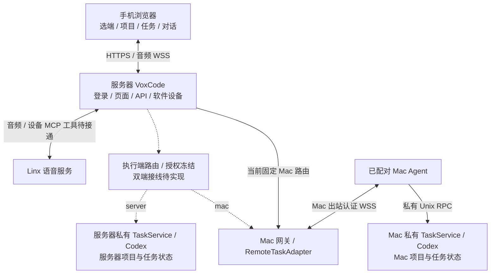

# VoxCode

VoxCode 在手机浏览器中管理 Codex 项目与任务。最新目标支持在页面选择**服务器
Codex 或已配对 Mac Codex**，项目、任务、会话、请求和语音按 `executionTarget`
隔离；登录不依赖 Mac Agent 在线。当前正式控制面仍固定 Mac 路由，双端选择尚待接线。

## 当前架构与状态

下图表示目标架构，虚线为待接线部分；Mac Agent 主动出站连接服务器。



项目 → 任务 → 子任务；主命令「新建项目」支持所选端已有目录与新建目录，项目行
`+` 创建任务。同任务追问使用该端该任务已保存的 UUID。提交文字或语音执行指令
直接执行，保留修订号、请求去重、目标归属、沙箱和 Codex 自身权限检查。
登录成功、控制服务可达和所选执行端在线状态分别记录。

| 能力 | 当前边界 |
| --- | --- |
| Mac 控制与正式语音传输 | 已有严格 CA HTTPS/WSS、配对 Mac 在线、合成音频 ASR 与 Mac Codex 写入证据；探针使用旧创建/确认流程 |
| 同 UUID 续聊核心 | [PR #127](https://github.com/liyan-04/voxcode/pull/127) 已合入 `f28553f`；[#124](https://github.com/liyan-04/voxcode/issues/124) 页面候选未部署 |
| 项目登记 / 提交即执行 / 双执行端 | 产品合同已明确，项目/API/页面与按端隔离的组合接线仍待交付 |
| 设备侧 MCP 语音控制 | SDK 支持 `tools/list` / `tools/call`，正式 provider 仍注册空工具；实际执行→结构化结果→继续语音未交付 |
| 手机验收 | 正式合成音频探针不证明实际 iPhone 麦克风、TTS、设备 MCP 或蜂窝网络成功 |

完整组件图、文字追问/语音工具时序、各 Issue 状态及回滚边界见
[当前架构](docs/architecture/phone-mac-linx-current.md)；协议见
[Mac 控制面合同](docs/architecture/mac-agent-control.md)。

## Linux 控制面

需要 Node.js 22+、专用非 root 服务账户和已核对归属的 HTTPS 监听者。
从已审阅源码安装锁定依赖，准备私有控制配置、登录/配对状态和严格 CA/TLS；配置结构见
[`control.json.example`](apps/server/deploy/control.json.example)。

```sh
npm ci --ignore-scripts --prefix apps/server
npm ci --ignore-scripts --prefix packages/voice
VOXCODE_CONTROL_CONFIG=/absolute/private/control.json node apps/server/control-cli.mjs preflight
VOXCODE_CONTROL_CONFIG=/absolute/private/control.json node apps/server/control-cli.mjs start
```

`start` 为前台启动，使用 SIGINT/SIGTERM 正常停止。它当前只组合 Mac 控制面；
`voiceAvailable` 表示已配置，不表示实际识别或工具执行成功。依赖安装不等于服务安装。

对**已经安装且确认归属**的当前 Linux 服务，生命周期命令为：

```sh
sudo systemctl start voxcode-control.service
sudo systemctl stop voxcode-control.service
sudo systemctl restart voxcode-control.service
sudo systemctl status voxcode-control.service --no-pager
```

新机器的一键 `install`、受检更新/回滚和数据保留卸载由
[#122](https://github.com/liyan-04/voxcode/issues/122) 实现，尚不能作为已发布入口。
现有 unit [模板](apps/server/deploy/voxcode-control.service)需操作者核对账户、路径、配置、
服务和端口归属后安装；当前没有完整、已验证的自动安装命令。服务器本地执行端的
组合生命周期是新增需求，不能把历史 `scripts/server/` 当作当前双端安装工具。

## Mac 执行端

需要 Node.js 22+、Git、已认证 Codex CLI、私有项目注册表/任务状态/socket、已配对
Agent 配置、Keychain token 和可信网关 CA。凭据不放 argv、源码、页面或任务日志。
配置说明见 [Mac Agent](apps/mac-agent/README.md) 与
[任务服务](apps/server/README.md)。安装依赖后可分别前台启动：

```sh
npm ci --ignore-scripts --prefix apps/server
npm ci --ignore-scripts --prefix apps/mac-agent
node --env-file=/absolute/private/task.env apps/server/task-cli.mjs start
```

确认私有任务 RPC 就绪后，在另一终端启动 Agent：

```sh
NODE_EXTRA_CA_CERTS=/absolute/private/issuer-ca.pem node apps/mac-agent/cli.mjs \
  --config /absolute/private/agent.json --task-socket /absolute/private/task.sock
```

对**已经安装并核对 plist、进程及路径归属**的正式 Mac 服务，使用准确标签
`io.voxcode.control-task` 与 `io.voxcode.control-agent`，不要套用旧模板标签。
以下占位路径替换为该安装实际的已审阅 plist；先任务服务后 Agent：

```sh
VOXCODE_LAUNCH_DOMAIN="gui/$(id -u)"
launchctl bootstrap "$VOXCODE_LAUNCH_DOMAIN" /absolute/owned/io.voxcode.control-task.plist
# 确认私有任务 RPC 就绪后执行下一行。
launchctl bootstrap "$VOXCODE_LAUNCH_DOMAIN" /absolute/owned/io.voxcode.control-agent.plist
launchctl print "$VOXCODE_LAUNCH_DOMAIN/io.voxcode.control-task"
launchctl print "$VOXCODE_LAUNCH_DOMAIN/io.voxcode.control-agent"
```

停止按反序；执行前先核对活动任务，停止任务服务可能中断本端执行：

```sh
launchctl bootout "$VOXCODE_LAUNCH_DOMAIN/io.voxcode.control-agent"
launchctl bootout "$VOXCODE_LAUNCH_DOMAIN/io.voxcode.control-task"
```

重启使用上述两条 `bootout`，再依次执行 task/Agent 的 `bootstrap`，中间核对 RPC 就绪。
这些原生命令不包含安装归属/健康自动判定；已加载的 job 不能再次 bootstrap。
统一 `install/start/stop/restart/status` 及受检 update/rollback/uninstall 仍由
[#122](https://github.com/liyan-04/voxcode/issues/122) 交付，此处不把候选脚本当成已发布工具。

## 恢复与验证

只更新/停止已确认归属的 VoxCode 服务。源码包包含 server、Mac Agent、control-protocol、
voice 源码及各自锁定依赖；私有配置、凭据、配对、注册表和任务数据留在 release 外。
回滚需核对精确源码版本、hash、协议/状态兼容及健康，保留上一版；不回滚项目文件，
不重放未知操作，不删除持久 guard/ledger 强制启动。默认卸载保留配置与业务数据。

本次是文档/规则更新，没有执行上述安装、服务或线上变更。当前服务/设备证据以
[状态表](docs/architecture/phone-mac-linx-current.md#能力与证据快照)为准。
本地策略校验入口为 `npm run test:policy`；运行时验证按对应模块的测试与验证记录执行。

- [架构索引](docs/architecture/README.md)：当前入口和历史设计边界。
- [验证记录](docs/verification/) / [独立评审](docs/reviews/)：命令、环境与实际证据。
- [AGENTS.md](AGENTS.md)、[CONTRIBUTING.md](CONTRIBUTING.md)：Issue、路径、Git/PR 和评审规则。
