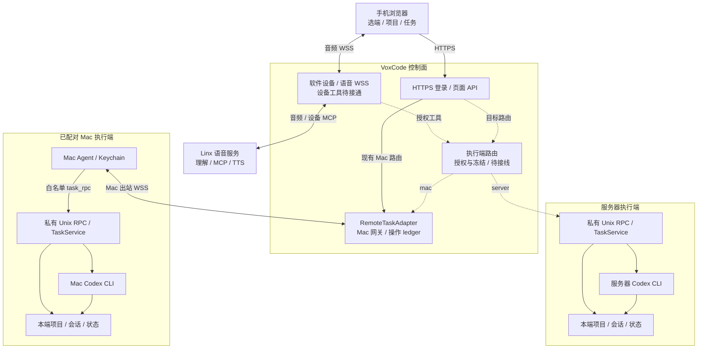
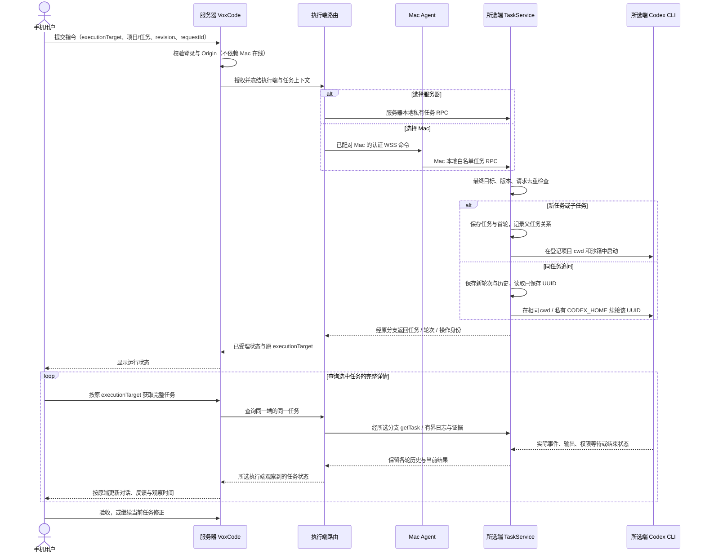
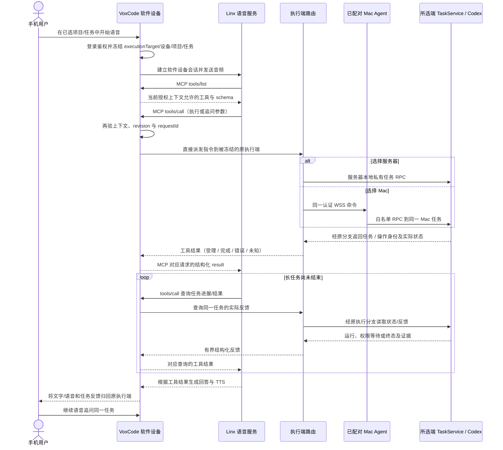

# 手机、Mac 与 Linx 当前架构

更新：2026-10-25，关联 [#125](https://github.com/liyan-04/voxcode/issues/125)。
本文描述最新产品合同，并分别标记源码与部署证据；文档工作区基线为 `fe51a88`，
另已核对续聊核心 [PR #127](https://github.com/liyan-04/voxcode/pull/127) 合入 `f28553f`。已记录的
正式线上探针为 `de10f5b`，两者不是同一个版本。最新双执行端范围覆盖此前的
Mac-only 限制；历史原生 iOS/Relay 和额外草稿确认不能覆盖此处约定。

## 产品与执行模型

手机浏览器通过服务器上的 VoxCode 选择**服务器 Codex 或已配对 Mac Codex**。
控制面负责登录、入口与路由，所选执行端负责自己的项目、任务、会话、代码与证据。
文字与 Linx 语音进入同一目标任务，不能在另一个端重复执行或接收其他端的结果。

| 用户操作 | 约定行为 |
| --- | --- |
| 执行端选择 | 切换服务器或已授权 Mac；项目、任务和状态仅显示所选端，离线 Mac 不阻断登录 |
| 主命令「新建项目」 | 选择所选端授权范围内的已有目录，或在该端管理根下新建目录；登记本身不创建任务 |
| 项目行 `+` | 在该项目创建任务；任务内可创建子任务 |
| 提交文字/语音执行指令 | 直接开始执行，保留版本、请求去重与 Codex 自身权限检查，无额外草稿确认 |
| 当前任务继续对话 | 复用该执行端、该任务持久化的 Codex UUID，追加轮次与反馈；不新建任务或随意选择会话 |
| 任务标签 | 仅显示所选端勾选项目的任务，按最后对话时间排序，旧数据以创建时间回退 |
| 查看进展并修正 | 获取当前轮次实际输出/事件/结果，继续追问，直到用户验收 |

已有目录必须满足项目/Git 边界；需要初始化 Git 时使用明确选项，新建目录不能覆盖
现有路径。目录浏览仅返回授权范围内的有界目录元数据。任务/子任务关系通过项目和
父任务 ID 表达；同任务追问追加轮次，与新建子任务不同。

登录会话、控制服务可达和所选执行端在线状态必须分别展示。登录只验证控制面身份，
不能等待 Mac Agent 启动、连接或任务 RPC 成功。选择服务器不依赖 Mac；选择离线
Mac 时保留该端输入并显示不可派发，不能自动改投服务器。

## 组件与信任边界

下图是双端目标架构。当前正式控制面仅接通 Mac 分支；执行端路由与设备 MCP 执行
工具为待接线部分，均用虚线标记。Mac Agent 是主动出站连接方。

[`control-cli.mjs`](../../apps/server/control-cli.mjs) 启动服务器控制面；
[`apps/mac-agent/cli.mjs`](../../apps/mac-agent/cli.mjs) 连接网关；Mac 上的
[`task-cli.mjs`](../../apps/server/task-cli.mjs) 启动本端任务服务，服务器也可复用此模块。
`apps/server/` 的目录名不决定部署位置；旧 `server-cli.mjs` 保留独立服务器执行模式，
不能据此声称当前控制面已有双端切换。
协议与字段约束见 [Mac Agent 控制面合同](mac-agent-control.md)。

手机只持有自己的登录会话。服务器持有 Linx 凭据和设备 token 摘要，Mac Agent
从 Keychain 取设备 token，模型凭据留在实际执行端的私有任务身份中。项目/会话选择权
来自认证上下文与该端注册表；模型工具参数不构成额外授权。每个现有任务服务实例
有一个全局执行槽，双端接入不能共享或覆盖彼此任务数据；未交付
每任务独立 worktree 或多租户文件隔离。

跨端身份至少包含 `executionTarget + projectId + taskId`，请求还需绑定 owner 和稳定
requestId。浏览器草稿、请求去重、标签、完整详情和迟到响应均按目标分别保存/校验，
不能只按项目或 taskId 命中缓存。切换端不转移已提交任务、会话 UUID 或未知操作；
结果仍归原端。目标 ID 由服务器授权目录解析，不能让客户端指定任意 socket、路径或设备。

## 文字提交与同任务追问

以下为直接提交的目标流程，不声明现有页面已接通。底层当前仍有 `startTask` /
`confirmTask` 两阶段原语，新合入的 `continueTask` 也先保存待执行轮次；组合层需在一次
用户提交内完成校验与派发。不得删除修订号检查或用重复请求绕过权限来消除旧交互。

只用任务保存的 UUID；禁止 `--last`、客户端/模型传 session 或续接失败后静默新建。
同任务同时最多一个活动轮次。列表使用有界摘要，选中任务通过 `getTask` 读取完整
历史，轮询不能用列表摘要抹掉对话。执行反馈与结果来自实际事件；`getDiff` /
`getChecks` 未采集时保持 `collected: false`，不能把自然语言「测试通过」当作检查证据。
执行完成、Codex 权限批准和用户验收分别记录；取消不回滚文件。

## 设备 MCP 语音往返

这里的「设备侧」是服务器中代表当前手机会话的 **VoxCode 软件设备**，不是让手机
直接连 Mac。设备工具必须绑定 `executionTarget`、登录账户、执行设备、项目、任务、语音会话与
`contextVersion`，录音开始冻结目标，执行前再次校验。云端 MCP token 或模型 tool
message 都不能代替这条授权绑定。执行端在录音开始冻结，后续页面切换不能将工具
请求或结果转移到另一端。

「已受理」不是「执行成功」。工具未知结果需要按原操作身份查询/对账，不换
requestId 再执行。工具不接受任意路径、shell、owner、执行端或会话 UUID 作为额外授权，
不能代答 Codex 权限批准或用户验收。中止录音只关闭对应语音资源，不等于取消任务；
执行端/项目/任务切换和迟到语音回调不得污染其他上下文。

## 能力与证据快照

`fixture/local` 仅证明本地行为，`live` 表示真实服务，`device` 表示真实手机；
合入、部署和用户验收互不替代。以下状态以本文日期和基线为界。

| 能力 | 源码 / 候选状态 | 已有真实证据与剩余关口 |
| --- | --- | --- |
| 双执行端与登录独立性 | 最新用户要求；当前 `control-runtime.mjs` 仍固定 Mac RemoteTaskAdapter，旧服务器执行模块可复用 | 页面选端、目标授权/隔离、按端目录/任务/草稿/请求/标签缓存、登录脱离 Agent 依赖均需接线与专项验收；不宣称已上线 |
| 服务器到 Mac 执行 | 主线已有 gateway、Agent、RemoteTaskAdapter 与私有 RPC | 正式 `de10f5b` 探针：严格 CA HTTPS/WSS、Mac 在线、`executionHost: mac`、`simulation: false`，Mac Codex 实际写入与回答通过；该探针使用旧创建/确认流程 |
| 任务标签筛选/排序 | [PR #123](https://github.com/liyan-04/voxcode/pull/123) 已合入 `fe51a88`，支持勾选项目与创建时间回退 | 已有本地浏览器 fixture；正式线上探针版本早于该合并，未据此证明部署 |
| 同任务 UUID 续聊与轮次历史 | [#114](https://github.com/liyan-04/voxcode/issues/114) 核心经 [PR #127](https://github.com/liyan-04/voxcode/pull/127) 合入 `f28553f`，两份独立评审 PASS、78 项聚焦测试 | 已记录真实已安装 CLI 的同 UUID 记忆与项目外写入拒绝；页面候选尚未部署，完整 gateway/页面/线上续聊仍待验证 |
| 完整对话与执行反馈页面 | [#124](https://github.com/liyan-04/voxcode/issues/124) 进行中，需独立保留选中任务详情并轮询 | 已部署页面仍缺续聊，不能把候选核心视为可用页面 |
| 项目登记与主命令 | [#115](https://github.com/liyan-04/voxcode/issues/115) 独立 registry 候选冻结，尚待评审和 RPC/HTTP/配置集成；[#124](https://github.com/liyan-04/voxcode/issues/124) 承接页面，双端隔离为新增要求 | 已部署页面主命令仍不符合「新建项目」；所选端已有/新建目录两种真实流程均待集成验收 |
| 提交即执行 | 最新用户合同；现有任务/续聊仍有两阶段原语 | 直接提交的页面/API/语音组合接线待完成；旧显式确认探针不能证明新交互 |
| 语音传输与 ASR | 主线有 `/ws/voice`、会话/录音目标冻结与 Linx provider | 正式线上合成 PCM 的 ASR 匹配且 Mac 写入验证通过，但没有自动创建任务；未验证真实 iPhone 麦克风或手机 TTS |
| 设备 MCP 执行与继续语音 | [`packages/voice`](../../packages/voice/src/index.js) 支持 `tools/list` / `tools/call`；正式 [`voice-provider.mjs`](../../apps/server/voice-provider.mjs) 仍为 `tools: []`、`writeReady: false`，云 MCP 查询与设备工具分离 | 未交付工具列表→执行调用→冻结端实际动作→结构化结果→继续语音的真实链路；双端绑定也是待实现要求，ASR 成功不能关闭此关口 |
| 崩溃恢复与统一生命周期 | [#121](https://github.com/liyan-04/voxcode/issues/121) 内核归属候选已评审待发布；[#122](https://github.com/liyan-04/voxcode/issues/122) 实现 Linux/Mac 生命周期与受检更新/回滚 | 候选脚本/进程测试不等于正式服务更新、Mac launchd 或重启恢复验收 |

可复查的已合入证据见 [Mac 控制运行记录](../verification/mac-control-runtime.md)、
[浏览器语音后端记录](../verification/browser-voice-backend-2026-10-25.md)、
[标签页验证](../verification/project-task-tabs.md) 和
[Mac/Linx 读写探针](../verification/mac-linx-read-write-2026-10-25.md)。这些记录保留
其当时环境与交互，不将较早的探针混称为本次正式设备 MCP 验收。
正式部署合成音频探针只在本文汇总脱敏结果，私有录音、配置和原始日志不进入仓库。

## 部署与回滚边界

| 所在端 | 管理边界 | 更新 / 回滚要求 |
| --- | --- | --- |
| Linux 控制面 | 当前 `voxcode-control.service`：HTTPS/WSS、页面、网关、语音；双端路由待接入 | 核对服务/监听者归属、精确源码 revision、包 hash、私有配置与严格 CA/TLS；发布到新 release，预检和健康检查确认后切换；保留上一版与操作 ledger |
| Linux 服务器执行端 | 本地私有 TaskService/Codex，独立任务身份、socket、项目注册表和状态；组合服务与生命周期接线待设计落实 | 与控制面分开管理和健康检查；不能复用 Mac 任务/UUID/请求数据，不因 Mac 离线停止或拒绝登录 |
| Mac | `io.voxcode.control-task` 与 `io.voxcode.control-agent`；先任务服务后 Agent，停止按反序 | 先核对活动任务、私有 socket、Keychain、项目/任务数据及协议兼容；回滚源码不回滚代码变更或历史，不重放未知命令 |
| 统一工具 [#122](https://github.com/liyan-04/voxcode/issues/122) | 当前候选先管理 Linux gateway 和 Mac task/Agent；统一 `install/start/stop/restart/status/logs/uninstall`，含受检 update/rollback | 服务器执行端是新范围，不能宣称既有候选已覆盖；分独立能力验证、评审、PR 后发布，本文不提供尚未合入的命令作生产入口 |

源码包必须包含 server、Mac Agent、control-protocol、voice 源码和各自锁定依赖；
私有配置、凭据、配对、项目注册表与任务数据置于 release 外。默认卸载只移除已确认
归属的服务注册与运行文件，保留这些数据，不隐式 purge。旧 `scripts/server/` 和
`voxcode.service` / `voxcode-task.service` 管理的是历史独立服务器模式，不能拿来替换当前 gateway，
也不能未经集成就视为双端部署方案。

禁止停止无关端口占用者、为重启删除持久 guard/ledger、清空任务状态或重建配对。
持久 guard 文件可以保留，活跃归属必须以锁与实际进程证据判断。断网时已启动的
Mac 任务可继续，重连先对账；停止服务器不等于取消 Mac 任务。

已有手工启动基线见 [Mac 控制运行记录](../verification/mac-control-runtime.md)，
正式语音需额外安装 `packages/voice` 锁定依赖；旧记录中的 server-only 打包示例
不足以构建完整语音包。部署、回滚和已安装服务变更由协调者负责，文档或脚本实现
不扩大线上权限。每个独立能力可在验证/评审后单独合入；本架构 PR 保持打开供用户审阅。
