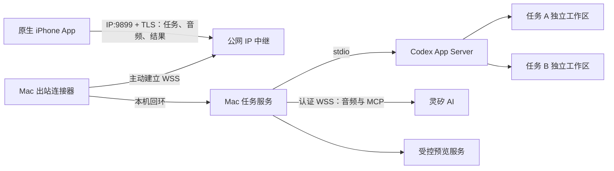

# VoxCode 参赛方案

日期：2026-10-23。状态：用户已确认继续，恢复实现；远程部署仍暂缓。下文描述目标能力，不代表已经交付。

## 1. 产品定位

**人在户外，用 iPhone 和灵矽 AI 对话，让公司 Mac 上的 Codex 完成开发，并在手机上检查结果、提出修改和验收。**

产品围绕“说清需求 → 确认任务 → 执行开发 → 看见证据 → 修改或验收”设计。原生 iPhone App 是控制与验收端；Mac 是代码执行端；灵矽 AI 是语音协作层。

第一版面向已有 Git 项目、离开电脑后仍需推进小型开发任务的人。适合页面调整、可复现的小缺陷、带明确检查命令的功能增量。涉及复杂调试、大规模重构或多环境发布时，应提示回到 Mac 处理。

## 2. 已确定的需求与本方案建议

| 项目 | 已确定或建议 |
| --- | --- |
| 手机交付 | 已确定：原生 iOS，可在指定 iPhone 上安装运行，不能悄悄改为 PWA |
| 远程场景 | 已确定：手机使用蜂窝网络，公司 Mac 在其他网络也必须可控 |
| 语音产品 | 已确定：语音相关能力使用灵矽 AI；Codex 负责代码执行 |
| 并行任务 | 已确定：两个并发不足，不能固定上限为二；建议任务列表至少容纳 20 个未归档任务，默认 4 个执行名额，可配置为 1–8 个 |
| 仓库 | 已确定：设计、决策、评审、验收记录和代码进入 liyan-04/voxcode |
| 开发方式 | 已确定：多 Agent 并行，各端两位独立专家评审 |
| 部署 | 已确定：暂缓；以后恢复时先检查 bili-xs8 的 9899，已占用就停止并通知 |
| 网络资源 | 已确定：用户目前只有 HTTP + 公网 IP，没有域名或现成 HTTPS；建议由项目在同一 IP:9899 上增加 TLS 和定向证书信任，无需用户提供域名 |
| 项目范围 | 建议：一台 Mac、一个预先授权的 Git 项目、一套已准备好的 Web 演示项目 |
| Codex 控制范围 | 建议：管理 VoxCode 创建并持有的 Codex 会话，后续指令继续该任务；接管已经打开的 Codex Desktop 聊天不列入两天承诺 |
| 预览范围 | 建议：支持一种固定 Web 项目的运行与手机预览，先把完整闭环做实 |
| 语音交互 | 建议：点击开始/停止录音、短轮次对话、按钮停止播报，执行前在手机确认 |

项目与预览范围、Codex 会话边界和现场屏幕路线，需要在继续开发前确认。

## 3. 三个完整开发场景

### 场景 A：在外面提出需求并检查页面

1. 手机选择已配对 Mac，打开“新任务”，说：“给登录页加一个手机号登录入口。”
2. 灵矽 AI 询问必要信息：“这次只演示页面交互，还是要接真实短信服务？”
3. 用户回答“只做页面和校验”。手机出现任务草稿与验收条件：入口可切换、空手机号有提示、演示环境不发送真实短信。
4. 用户点“开始开发”，Mac 创建任务工作区，Codex 修改代码并执行检查。
5. 手机显示真实状态和最近活动；用户也可问：“登录页做到哪了？”
6. 完成后手机展示变化摘要、检查结果、变更文件、截图和“打开预览”。
7. 用户操作预览后说：“错误提示放到输入框下面。”确认追问后继续同一任务。
8. 新结果形成新版本；用户对照验收条件点“验收通过”。

### 场景 B：多任务并行，随时切换

任务 A 修改登录页，任务 B 修复商品列表空状态。它们使用不同 Git worktree、分支、测试数据和预览产物。统一静态服务按任务/版本读取各自的产物快照。

用户还可以同时安排任务 C 补充输入校验、任务 D 修复帮助页，以及更多待执行任务。任务数量与正在运行的数量分别管理，不因执行名额用完就禁止创建和查看任务。

用户可点任务切换，也可说“切到登录页”。名称不唯一时，灵矽 AI 给出候选项。导航切换可以由语音完成；任何开发指令仍显示目标任务并由用户确认。

录音开始时固定任务及版本。如果录音期间切换了页面，这段录音仍属于原任务，草稿明确标注目标；不能把它静默发送给新选中的任务。如果原任务已更新，提交前要求重新确认当前版本。

一段录音与围绕它的澄清属于同一目标。“切到 B，再把按钮改红”这样的混合指令，先展示切换候选，确认后创建 B 的新草稿，不从旧草稿直接变更目标。从未提交的草稿遇到版本变化时，保留文字并展示新旧版本，用户重新审阅后生成新的提交编号；响应不确定的已提交指令先对账，重试只能沿用原编号、版本和内容。

建议默认四个执行名额，第五个任务排队；设置页可调整为 1–8 个。上限依据 Mac 资源和模型额度选择，不能承诺加倍并发就加倍速度。降低上限只影响后续调度，不强行终止在途任务。等待 Codex 操作授权和停止中的 turn 仍占名额；尚未提交的澄清草稿及已完成待验收任务不占名额。同一任务始终只有一个活跃 turn。

列表顶部显示“执行中 4/4、排队 N、待处理 N”，支持全部、执行中、排队、待处理筛选。授权、澄清和失败聚合到待处理入口，保留所属任务。每项显示标题、短编号、状态、最近活动及时间；重名任务通过短编号和状态澄清。模型限流、资源不足和 Mac 离线应显示具体原因，区别于正常等待执行名额。

首版任务之间不自动合并；有代码依赖的任务应顺序执行。手机断网不取消 Mac 已接收的任务。

### 场景 C：失败、授权或网络中断

- 检查失败：手机显示失败命令、退出码和关键输出，灵矽 AI 解释已知原因；证据不足时明确说“还不能确认原因”。
- 需要操作授权：展示实际操作、目录及影响范围，用户在手机点允许或拒绝。展示不完整的授权请求应拒绝，并提示回到 Mac 处理。
- 手机断网：保留上次快照与时间，显示离线；恢复后拉取实际状态。提交响应丢失时，重试沿用同一请求编号和内容。
- Mac 断网或休眠：显示执行端不可达；不能把“无新消息”当成仍在正常运行。
- 取消任务：显示“停止中”，确认进程结束后才释放执行名额。取消不回滚已修改的文件。
- 执行端异常重启：显示“需在 Mac 恢复”，先确认旧执行已结束，再继续调度。

## 4. 手机端需要接收什么

| 信息 | 手机展示 | 用途 |
| --- | --- | --- |
| 连接 | Mac/项目名称、在线状态、最后同步时间 | 知道当前在控制哪台机器 |
| 任务 | 标题、当前阶段、验收条件、任务版本 | 快速识别任务和预期结果 |
| 进度 | 真实状态、最近活动、等待原因 | 判断执行、排队、等待授权还是出错 |
| 变更 | 摘要、文件列表、可展开 diff，包含新增文件 | 检查实际做了什么 |
| 检查 | 命令、退出码、通过/失败/未运行、关键输出 | 区分“说完成了”与“实际验证了” |
| 界面结果 | 绑定任务版本的截图及可操作预览 | 检查布局与交互 |
| 待处理 | 澄清问题、操作授权、失败说明 | 让阻塞有明确下一步 |
| 验收 | 条件与证据的对应关系、未验证项 | 决定接受、继续修改或回电脑处理 |

页面采用四个主要视图：连接设置、任务列表、任务详情、结果验收。语音以底部面板进入，始终显示录音目标。任务详情分为“动态”和“结果”，默认展示简洁摘要，原始日志、diff 和检查输出按需展开。

每次提交持久化用户确认的验收条件，每条有稳定编号，并关联任务版本、证据和验证方式。结果页逐条标注“自动检查通过 / 人工检查通过 / 失败 / 未验证”，模型的解释不能自行把条件标为通过。需要人工操作的条件由用户在预览后确认；必选条件失败或未验证时，首版不允许点“验收通过”。验收保存当时版本、条件状态、证据引用及时间，版本已过期或离线时不能提交当前版本验收。

追问默认继承条件，涉及范围调整时再次展示并确认。新版本产生新的条件/证据快照，历史记录仍可查看。一项测试通过只支持其覆盖的条件，不能推导整个任务通过。

不显示臆造的完成百分比。状态至少区分：排队、执行、等待输入、等待授权、停止中、中断、失败、执行完成。结果是否已验收单独记录。

首版只承诺前台同步；App 回到前台后自动恢复状态。APNs 后台推送不进入两天必交范围，不能承诺锁屏后一定及时提醒。

## 5. 灵矽 AI 如何深度参与

### 职责划分

- **灵矽 AI**：实时语音识别、短轮次澄清、理解当前任务、生成待确认草稿、查询进度、解释结果、语音播报。
- **Mac 任务服务**：判断权限，绑定任务和版本，保存记录，管理执行、授权、预览与验收证据。
- **Codex**：理解已确认的开发任务，修改代码，执行检查，返回真实结果。

手机通过麦克风采集音频，经已认证链路送到服务端，再由服务端连接灵矽 AI。灵矽凭据留在服务端。输出音频由原生播放器播放；必须验证实际输出编码及对应解码路径，不能把收到音频帧等同于手机已能播报。

灵矽设备文档描述的输出为 Opus。建议使用固定版本的成熟 libopus 解码路径，保留采样率和帧边界，再交给原生音频引擎播放；首轮探针要验证真机可听、停止清空及重新录音。输入配置为 16 kHz 单声道 PCM，不能据此假定输出也是 PCM。首版结果播报指用户在前台打开语音面板询问后播报，不承诺任务完成后锁屏自动播报。

首版采用单路语音会话、轮流说话：点击开始/停止录音，播放时可点停止，开启下一轮录音前先停止播报；不承诺自动检测用户插话。多个开发任务可以并行执行，语音并发与开发并发独立。手机进入语音面板时，服务端提供最少必要上下文：当前项目、目标任务、版本、验收条件和最新状态。完整仓库和密钥不作为默认上下文。

锁屏、来电、音频输入切换或传输失败时停止采集，保留草稿并显示原因；回到前台不自动开启麦克风。丢弃后重录时，旧会话的请求成功/失败、音频、转写或播报都不能修改新会话。

### 最小工具集

以下是应用需要实现并注册的工具，并非宣称灵矽已内置这些功能。通过设备侧 MCP 承接工具调用，沿用由服务端建立的认证会话；首版不额外开放公网云端 MCP 入口。

| 工具 | 能力 | 执行边界 |
| --- | --- | --- |
| `list_tasks` | 列出当前授权项目的任务 | 只读 |
| `get_task_status` | 查询指定任务真实状态和最近活动 | 只读 |
| `get_task_evidence` | 获取当前版本的结果和检查摘要 | 只读，标注证据不足 |
| `propose_task` | 整理需求和验收条件 | 只生成草稿，手机确认后执行 |
| `propose_followup` | 形成当前任务的修改草稿 | 固定任务及版本，手机确认后执行 |
| `propose_focus` | 提出任务切换候选 | 仅改变导航，不能迁移已有录音 |

服务端保存“配对手机 → 授权项目 → 语音会话 → 固定任务/版本”的映射，工具不能通过参数改变授权身份或项目目录，手机撤销配对后立即失效。智能体预先配置提示词模板，通过已验证的 `hello.agent_params.custom_replace_prompt` 占位符填入最少必要标签，实时进度通过工具读取；不能假定附加任意 JSON 就建立了上下文。

草稿工具保存有有效期的服务端 draft ID、来源、目标版本和验收条件，再通过已认证事件让手机取回、编辑及确认。语音识别文本和工具草稿汇合为一个待确认对象；最终提交引用用户确认的草稿，并生成独立、持久的 request ID。MCP 调用编号只用于该连接的工具去重，不能代替最终提交身份。短轮次重建语音连接时，澄清结果仍保留在服务端。

设备侧 MCP 的能力协商、初始化、工具列表、一次真实状态查询及一次草稿回传均纳入首轮探针。工具参数校验、超时和返回大小必须受限；第三方应用的 SSE 路线仅作参考，不与端侧 MCP 隐式混用。

首个真实闭环先接通语音识别、草稿确认、开发及结果。随后接入工具查询和语音结果播报；这两项完成后，才符合本方案“语音协作层”的交付定义。仅有听写输入属于阶段成果。

工具返回的代码、日志和模型文本都按数据处理，不能提升权限。停止开发、允许敏感操作、验收结果由明确 UI 操作完成。打断语音播报只停止播报。

协议参考：[设备 WebSocket](https://linx.qiniu.com/docs/xrobot/platform/websocket)、[设备侧 MCP](https://linx.qiniu.com/docs/xrobot/mcp/hardware-mcp)、[第三方应用](https://linx.qiniu.com/docs/xrobot/guide/third-app)。设备注册、账号权益、实际语音质量与音频格式仍需现场联调。

## 6. 连接与执行架构

建议技术栈：iOS 使用 SwiftUI/AVAudioEngine/WKWebView，Mac 与中继使用 Node.js 22+，执行接口采用 Codex App Server。固定演示项目建议使用 Vite + React + TypeScript，配置可重复的检查/构建命令；Mac 工作台使用轻量 Web 页面。具体依赖版本在恢复实现时锁定，实际协议以安装版本验证为准。

中继通过 Mac 主动建立的连接转发手机请求，公司 Mac 不需要开放入站端口。公司网络仍须允许出站连接，Mac 需要保持供电、登录和唤醒；这些条件须用真实网络验证。

连接状态区分手机到中继失败、中继在线但 Mac 离线、Mac 在线但 Codex/灵矽不可用。音频和预览采用独立有界额度，不能占满取消、授权和状态请求的处理能力。首版音频输入有序分块上传，输出按序号短批次获取，保留 Opus 帧边界；缓冲超时或缺帧无法恢复时停止播报并显示原因。网络恢复后对账任务请求，不盲目重放录音、工具草稿或旧播报。

`121.52.250.201:9899/TCP` 是已指定的部署入口。用户只有 HTTP + IP，**不要求用户预先提供域名、HTTPS 服务或购买证书**。建议项目负责在该 IP 的同一 TCP 端口提供 TLS：iPhone 使用 `https://121.52.250.201:9899`，Mac 使用对应 WSS 出站连接，TLS 后的内部中继仍可使用本机 HTTP。

指定 IP 也可以使用 TLS。比赛版建议私有 CA 签发含该 IP 的 `iPAddress SAN` 证书，由签名 App 携带公开信任材料，Mac 连接器显式配置该 CA；严格校验指定身份、IP、有效期和 TLS。私钥只留在部署端，不进手机或 Git。初始信任材料通过签名包或线下核对传递，不能从首次公网 HTTP 响应下载后直接信任。证书轮换需更新对应信任配置。

iOS 17+ 支持针对具体 IP 配置 ATS 例外，键不带端口；按实际需要为该 IP 配置并结合严格手动信任。证书固定不会自动绕过 ATS，也不能关闭所有证书校验或接受任意证书。即使 ATS 例外允许明文，App 仍仅允许固定加密入口。URLSession 和 WKWebView 的信任处理需分别验证，不能把前者接通推定为预览接通。

原生 iOS 在适当配置下可以连接 HTTP；这里的限制是公网控制凭据、语音和代码的传输安全，并不是“没有域名就无法做 App”。如果外部入口必须保持纯 HTTP，备选是先建立标准加密 VPN，再仅在隧道内访问 HTTP；这会增加设备/服务器配置，需要另行选择。裸公网 HTTP 不作为本方案的户外控制基线，不自研一套应用层加密替代 TLS。

以上是待确认的部署设计，不是已部署能力。未来恢复时先检查 9899，若被已有服务占用则停止并通知，不能为加 TLS 擅自替换原服务。当前部署继续暂停，不能把本机中继计为户外验收通过。

手机与 Mac 配对后，凭据只授权给指定 Mac/项目，并存入 iOS Keychain。Mac 连接中继使用另一份机器凭据。中继不接收 Codex 或灵矽密钥；音频和必要任务上下文会经中继传输，并发送给灵矽处理，需要明确告知使用者。比赛版不宣称端到端加密。

### Codex 会话连续性

每个任务绑定一个由 VoxCode 管理的 Codex 会话和工作区。追问应继续该会话，保留原始需求和已确认的验收条件；不能每次追问都悄悄开启没有历史的新会话。

分别持久化任务 ID、代码输入版本、Codex thread/turn ID、不可变提交及 request ID；同一任务最多一个活跃 turn。首版只在该 turn 结束后提交追问，运行时可保存待确认草稿，暂不支持中途 steer。Mac/App Server 重启后先核对旧执行所有权与提交结果，再恢复原 thread；恢复历史不能代替停止旧进程。恢复时重新校验工作目录和权限。

优先使用安装版本实际支持的 App Server 会话持久化/恢复接口，先做协议验证。如果恢复不可用，显示恢复失败；“携带明确摘要重新执行”必须由用户确认，并标明上下文变化。已有 Desktop 聊天的接管需要另外验证，不能从终端共享会话能力推定 Desktop 聊天也可控制。

### 多任务隔离与调度

独立 worktree/分支隔离代码；独立构建产物、临时/数据目录隔离运行结果；每个任务最多一个活跃执行。工作区不是完整安全沙箱，不能承诺阻止所有跨任务访问。演示项目使用测试数据，避免多个任务写入同一数据库或真实业务环境。构建与截图另设资源额度，不能把模型 turn 的并发控制等同于系统资源完全隔离。

执行名额作为持久配置，不在产品逻辑里固定为二。首版建议配置范围 1–8，默认四；8 路真实运行的资源消耗与模型配额需另记实测结果。任务按队列调度，取消后须确认进程终止才释放名额，异常恢复仍保持所有权隔离。现有代码的双名额限制在方案批准后再修改，不能把本文的并发目标视为已实现。

任务完成后保留分支和结果，验收通过也不自动合并、推送或部署。后续提交修改会增加版本，使旧验收失效；旧证据只作为历史展示。

## 7. 手机如何看见真实预览

首版固定一种可构建为静态产物的 Web 项目，使用明确标注的测试数据，支持页面交互与客户端校验。Codex 进行真实代码修改和检查，预览运行真实构建产物。提前配置检查命令、构建命令、统一静态预览服务及健康检查，不依赖模型临时生成的任意公网地址，也不为每个任务长期运行一个开发服务器。

1. Codex 完成后执行约定检查，保存命令、结果和版本。
2. 登记不可变 artifact ID、所属任务/输入版本、构建结果和内容摘要。受控静态服务仅在本机运行，读取该产物快照，完成健康检查并生成截图。
3. 手机通过已认证中继访问该任务的预览；中继只转发服务端登记的任务路由，客户端不能传入任意主机、端口或文件路径。
4. 原生 App 使用受控 WebView 打开预览，控制 API 凭据不交给页面。App 通过原生认证请求换取短期、可撤销、仅授权指定任务/版本的预览会话，将 Secure/HttpOnly cookie 写入隔离的非持久 WebView 存储；cookie 的主机和路径范围覆盖该预览的页面及子资源。凭据不放在 URL 查询参数中。
5. 运行实例更新或版本变化时，旧截图和旧页面明确标记过期。预览未就绪时显示原因，不显示一个打不开的按钮。

支持矩阵：相对静态资源、同源 SPA 导航/刷新、客户端表单与测试数据交互。暂不支持真实业务后端、第三方登录、外部导航、开发热更新、WebSocket 或 Service Worker。预览网关只转发对应快照，不能用预览 cookie 调用控制 API；退出或撤销时使会话失效并清理 WebView 数据。后续版本不会覆盖旧快照。

单 IP、单端口条件下允许控制 API 与预览同 origin，服务端必须将权限分开：控制 API 只接受手机原生持有的 bearer，完全不认可预览 cookie；预览会话不能换取控制身份；页面没有 bearer，也没有任意原生调用桥。每个任务使用独立的 WebView 数据存储，禁止 Service Worker 和外部导航。cookie 路径与 HttpOnly 不是来源隔离的替代，真正边界是服务端任务/版本授权。独立预览 origin 作为未来加固选项，不再要求额外域名或端口。

仅发布约定产物目录的普通文件，拒绝越界路径、符号链接、目录浏览和私有配置；SPA 回退只能回到该产物入口。构建进程剥离桥接/灵矽凭据，演示资源打包在产物内，限制页面对外请求。快照、截图和预览会话都有大小、保留与并发上限。静态预览不持续读取仍在编辑的 worktree。

子资源、页面导航、IP 定向证书信任和实际交互都要经过真机测试，不能用截图替代可操作预览。错误证书、IP 不匹配、过期和撤销必须被拒绝；两天内不承诺任意框架或所有仓库都能直接运行。

## 8. AirPlay 与比赛题目的关系

远程任务控制使用 HTTPS/WSS；AirPlay 用于现场大屏展示，两者承担不同职责。建议 Mac 工作台展示任务、真实开发活动和预览，再通过系统 AirPlay 镜像到兼容接收端。

原题明确写了“通过 AirPlay 协议连接屏幕”。手机远程控制加系统镜像是否符合评审口径，需要赛前确认。若必须由应用直接发现/选择 AirPlay 接收端，当前路线不能算已经满足，要重新评估两天范围。不能用手机投屏视频冒充完整开发链路。

大屏沿用简洁 Web 工作台，不再做一个原生 Mac IDE。投屏和 Mac 不休眠需要真实演练；户外控制本身不依赖现场 AirPlay。

## 9. 两天开发计划与停止条件

这是约 16–20 小时有效开发时间的建议分配，以资源就绪和最小探针通过为前提，不是对现状可直接完成的保证。只在本方案确认后恢复实现。方案确认不自动恢复已暂缓的远程部署，部署仍等用户另行明确恢复。

| 阶段 | 工作 | 验证出口 |
| --- | --- | --- |
| 开工前 | 落实可用 Xcode/签名/iPhone、Codex 与灵矽账号、IP:9899 与公司网络；准备定向 TLS 设计及固定演示项目 | 无需用户域名或现成 HTTPS；资源有明确负责人，缺项单列阻断 |
| 第一天前 2 小时 | 最小探针验证安装、真实 Codex 修改、语音识别/可听播报、会话续接和一个受保护预览；获准恢复部署后尽早验证公网 | 及早暴露硬阻断，未通过则暂停次要功能；不承诺两小时内解决全部资源问题 |
| 第一天其余时间 | 并行完成 iOS 主流程、Mac 连续会话/状态/结果、灵矽识别与草稿；统一协议 | 单任务从手机发出并收到实际改动和检查结果 |
| 第二天前半段 | 完善受控预览、灵矽工具查询与播报、多任务切换和断线恢复 | 手机能检查真实页面并继续修改；户外链路有实际记录 |
| 第二天下半段 | 复核已发现问题，集中修复阻断项，完整演练并录制演示 | 验收表有实际记录，交付可安装构建与仓库材料 |

分工建议：iOS Agent、Mac Agent、灵矽/中继 Agent 并行；协调者维护共享契约、集成和验收。各 Agent 只修改负责路径，评审者不自审自己的实现。两位专家的各端评审随模块交付进行，不等到最后；新增预览和会话恢复先做设计复核。首个可安装版本就开始音频与前后台真机检查。共享接口调整先更新契约。

停止条件：原生 App 装不上、真实 Codex 不能完成任务、灵矽不能识别真实音频、公网链路无法接通时，优先处理这些阻断项，停止增加次要功能。原生安装与户外可控是已确定需求，不能通过改名或演示替身将它们移出验收。

## 10. 最终验收标准

| 验收项 | 通过条件 |
| --- | --- |
| 原生交付 | 指定 iPhone 可安装签名构建，麦克风、连接及页面流程真实可用；源码/模拟器构建不能替代 |
| 户外远程 | iPhone 关闭 Wi-Fi，用蜂窝网络提交任务；公司 Mac 在另一网络完成执行，手机收到结果 |
| 灵矽语音 | 一次真实澄清形成验收条件；可查询真实进度，并在手机听到基于证据的结果播报 |
| 真实开发 | Codex 实际修改授权项目；手机能看到新增/修改文件与真实检查结果 |
| 手机验收 | 打开可操作预览，对照条件验收，能对同一任务追问并检查新版本 |
| 连续上下文 | 追问沿用原始目标与当前会话；会话无法恢复时明确阻断或请求确认 |
| 任务管理 | 真机可浏览、筛选和切换至少 20 个持久化未归档任务，待处理项能定位所属任务 |
| 并行与切换 | 真实验证四个独立任务并行，工作区、构建产物和结果不串；第五个任务排队 |
| 并发配置 | 调度测试验证 1–8 配置、上限调整及名额释放；8 路真实模型运行单列实测，不预先承诺性能 |
| 语音路由 | 十次交替任务指令，包含录音中切换，错误任务修改为零；歧义指令须澄清 |
| 断线与重试 | 手机断网一分钟再恢复，能取回实际状态；同一提交重试不重复创建或执行 |
| 授权与停止 | 授权只生效一次；失效版本被拒绝；取消呈现停止中，完成后才释放名额 |
| 证据与版本 | 通过/失败/未验证明确区分；再次修改使旧验收失效，旧截图不能充当新结果 |
| 现场屏幕 | 在真实兼容接收端演示 AirPlay，确认符合主办方口径 |

验收结果记入仓库，区分自动化测试、模拟服务、本地真服务、真机和真实外网。不得用 fixture 通过来声称灵矽、Codex 或真机链路已经验证。

三到五分钟演示建议：户外语音提出需求 → 澄清并确认 → 多任务并行/切换 → 询问进度 → 打开真实预览与检查结果 → 语音追问 → 验收。开发耗时较长时可分段展示，但须说明剪辑，不伪造实时结果。

## 11. 需要准备的资源

| 资源 | 用途与现状 |
| --- | --- |
| 公司 Mac | 已有 Codex CLI；需可用账号、授权项目、持续供电、允许出站连接 |
| 完整 Xcode 与签名 | 当前开发机只有 Command Line Tools；原生构建/签名仍需完整环境 |
| iPhone | iOS 17+，允许开发测试与麦克风，具有蜂窝网络 |
| Apple 签名方式 | 指定设备开发安装可使用适当开发签名；TestFlight 需相应开发者资格。IPA 仍受签名及设备授权约束 |
| 灵矽 AI 资源 | 可用智能体、设备接入信息、语音服务权限；凭据通过环境或安全配置注入，不进聊天和 Git |
| 公网服务与 TLS | 用户提供 IP:9899，不提供域名或现成 HTTPS；开发侧负责 IP 证书、定向信任和 TLS 入口设计，部署暂缓 |
| 演示项目 | 无生产数据、启动稳定、检查命令确定、有明显可观察的页面结果 |
| AirPlay 接收端 | 兼容屏幕/接收设备与可用现场网络；开发与户外控制不需要另购嵌入式硬件 |

资源责任建议：用户提供可用的 Mac/指定 iPhone/签名权限、灵矽测试权限、服务器 IP:9899，并协调公司网络与现场屏幕；开发协调者负责 IP 定向 TLS、最小验证、协议适配和记录结果。最晚在恢复开发前明确负责人和可用时间。安装签名、真实语音、会话续接与预览作为首轮探针；公网检查在用户恢复部署授权后立即安排。TestFlight 属于可选分发方式，比赛默认采用指定设备开发安装。敏感配置通过安全渠道配置，不需要在聊天里发送。

## 12. 竞品与参赛表达

TRAE SOLO Mobile、Happy 和 HAPI 的公开材料已经覆盖手机下发、语音、任务或会话管理等能力。不能把“手机说话让电脑写代码”或“双向对话”宣称为独创。[调研记录](research/competitors-mobile.md)保留来源和未验证项；用户所指 Dot 的具体身份仍未确认，不为其编造功能比较。

VoxCode 的参赛重点建议放在：**通过灵矽把口头想法变成可检查的条件，再把真实代码、检查和页面结果交回手机，由用户验收当前版本。**

这是需要演示验证的产品重点，不能据此断言竞品没有类似能力。相同小任务在竞品上的实际体验可以作为后续对照；两天里优先完成自身闭环。

## 13. 当前代码与方案的差距

已有原生界面、Mac 执行服务、语音适配器、中继和本地测试代码。它们是实现基础，不等于本方案已经交付。

继续开发前必须认识到：原生构建/安装尚未验证；完整真实 Codex 修改尚未跑通；真实灵矽联调、手机语音播报、深度工具调用、可操作预览、可靠会话连续性及户外链路仍有缺口。最新复核还发现一个待修复的录音启动竞态，已保留记录。详细状态见[需求核对](requirements-audit.md)和[验证记录](progress.md)。

用户于 2026-10-23 要求先确认方案，现暂停源码修改、执行联调与部署。已有工作保留，后续按确认后的范围修订实现计划。

## 14. 建议确认的方案范围

1. **Codex 会话**：首版管理 VoxCode 创建的会话，保证同一任务追问连续；不承诺接管已经打开的 Desktop 聊天。
2. **两天范围**：一台 Mac、一个授权项目、至少 20 个任务的管理、默认四路/可配置 1–8 路执行名额、一种 Web 预览；原生安装、真实灵矽语音和户外访问保留为验收要求。
3. **屏幕路线**：任务控制使用 HTTPS/WSS，现场通过 Mac 工作台及系统 AirPlay 展示；赛前确认原题是否接受这一路线。
4. **IP 连接路线**：不要求现成 HTTPS 或域名，建议由项目在 IP:9899 增加 TLS，原生客户端定向核验证书；部署继续暂缓。

用户已在 HTTP/IP 与多任务范围调整后确认“好的，继续”。按本方案恢复实现；资源就绪及主办方 AirPlay 口径仍需实际确认。范围有调整时先修改本方案与验收表，再修改代码。

## 15. 本轮方案评审

两位独立专家已分别进行[移动产品与交付评审](reviews/proposal-mobile.md)、[架构与灵矽集成评审](reviews/proposal-architecture.md)。其主要建议已纳入本文：资源关口提前、验收条件持久化、录音和提交身份分离、连续会话对账、草稿可靠回传、真机 Opus 播放，以及隔离的静态产物预览。

评审支持总体方向，仍要求先确认范围与资源，不构成两天必然交付或真实链路已验证的结论。本文为确认稿，之后的接口、实现计划与代码按最终确认的内容同步修订。

用户随后补充“只有 HTTP + IP”并否定固定两任务并发；[网络与并发补充评审](reviews/network-and-concurrency-followup.md)记录了对应建议。本文已移除“用户必须提供域名/现成 HTTPS”和“最多两个执行名额”的前提。补充内容依然是方案，未恢复代码或部署。
